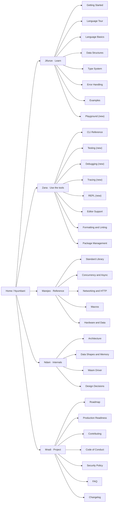

# Asili wiki — App Flow

As of 7 November 2026 · Victor Kaiuki

A reader lands on Home, picks a language, and the sidebar takes them by task: learn the language,
use the tools, look something up, understand the internals, or join the project.

## Sidebar structure (v1)

Today's sidebar groups the same pages differently ("Standard Library & Tooling" mixes reference and
tools). The new grouping separates doing (Zana) from looking up (Marejeo). Swahili pages appear in
the same groups, marked with the language.

## Page anatomy

Every page follows the same order, so readers know where to look:

1. **Title** and a one-sentence summary that answers "what is this for".
2. **Language link**: "Soma kwa Kiswahili" or "Read in English" when a twin exists.
3. **Example first**: the smallest runnable example, with "Iendeshe kwenye uwanja".
4. **Explanation**: short sections, one idea each.
5. **Reference**: tables of flags, functions or options.
6. **See also**: related pages, the `docs/` source file, and the source code location.

## Journey 1: learner (Swahili)

1. Arrives at Home from the website; clicks "Kiswahili".
2. Anza (Getting Started): installs Pata or opens the playground instead.
3. Ziara ya Lugha (Language Tour): each section's example runs in the playground with one click.
4. Makosa (Error Handling): sees a Swahili diagnostic, the same text the compiler prints.
5. Next: Mifano (Examples) or the Playground page.

## Journey 2: developer looks up a flag

1. Searches the wiki (GitHub search) or opens CLI Reference from the sidebar.
2. Finds the command's section: synopsis, every flag in a table, an example, exit codes.
3. Follows "See also" to Testing, Tracing or Debugging for the longer guide.

## Journey 3: editor user sets up debugging

1. Editor Support → "Debugging" link.
2. Debugging page: install the extension, press F5, what works (breakpoints, step over, step in,
   step out, pause, variables, set variable, evaluate, restart), what is still open (conditional
   breakpoints, a multi-frame call stack), how to use `pata-dap` from another editor.
3. Tracing page for when a debugger is not enough: `--fuatilia`, `pata fuatilia`, output formats.

## Journey 4: contributor adds a feature

1. Contributing → "Documenting a change".
2. Learns the rule: the wiki and `docs/` change together; the coverage check names any gap.
3. Adds the feature's section; CI's coverage and example checks pass.

## Edge cases

| Situation | What happens |
| --- | --- |
| Page has no Swahili twin yet | No language link; the Swahili sidebar shows the English page marked "(Kiingereza)" |
| Example deliberately invalid | Fenced as `asili,ignore`, no playground link |
| Feature not available in the browser | Example shows "Inahitaji Pata" instead of the playground link |
| Old page name linked from outside | Old page kept as a one-line pointer to the new name |
