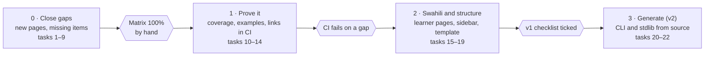

# Asili wiki — Implementation Plan

As of 7 November 2026 · Victor Kaiuki

Four phases. Phase 0 closes the gaps found on 7 November 2026 by hand; Phase 1 adds the check that
keeps the wiki complete; Phases 2 and 3 add Swahili and generated reference. Every task changes the
wiki and its `docs/` counterpart together.

## Roadmap

## Task tracker

| # | Task | Pages (wiki + `docs/`) | Covers | Phase | Status |
| --- | --- | --- | --- | --- | --- |
| 1 | Tracing page: `--fuatilia` values, `pata fuatilia`, output formats | Tracing; `docs/design/tracing.md` | WK-3 | 0 | Not started |
| 2 | Debugging page: VS Code F5, `pata-dap`, supported requests, other editors | Debugging; new `docs/howto/` page | WK-3 | 0 | Not started |
| 3 | Testing page: `#[jaribio]`, `jaribu` flags including `--chanjo`, `--chuja`, `--orodha`, `--json` | Testing; `docs/howto/01-run-tests.md` | WK-3 | 0 | Not started |
| 4 | Playground page: what runs in the browser, sharing, self-hosting | Playground; playground README | WK-3 | 0 | Not started |
| 5 | REPL page from `docs/repl/` topics, including `namba-kuu-sahihi` | REPL; `docs/howto/06-use-repl.md` | WK-3 | 0 | Not started |
| 6 | CLI Reference: `pata fuatilia`, all missing flags, "standalone tools" section (`pata-lint`, `pata-fmt`, `pata-lsp`, `pata-dap`, `tenda`) | CLI Reference; `pata/cli/commands/*.md` | WK-1, WK-2 | 0 | Not started |
| 7 | Editor Support: inlay hints; every VS Code command and setting | Editor Support; `docs/howto/02-use-lsp.md` | WK-4 | 0 | Not started |
| 8 | Standard Library: `ruwaza` and `usimbaji` | Standard Library; `docs/spec/05-standard-library.md` | WK-5 | 0 | Not started |
| 9 | Build targets `native`, `wasm`, `cortex-m` with examples | CLI Reference, Hardware and Data; `docs/howto/07-build-for-cortex-m.md` | WK-1 | 0 | Not started |
| 10 | Every `pata` command answers `--msaada` (prerequisite) | CLI code | WK-6 | 1 | Not started |
| 11 | `pata/core/tests/wiki_coverage.rs` reading the sources of truth | — | WK-6 | 1 | Not started |
| 12 | CI job with a wiki checkout running the coverage test | — | WK-6 | 1 | Not started |
| 13 | Example check: compile every `asili` block in the wiki | — | WK-NFR-2 | 1 | Not started |
| 14 | Weekly link check | — | WK-NFR-4 | 1 | Not started |
| 15 | Decide Swahili page naming | — | WK-7 | 2 | Not started |
| 16 | Swahili twins: Home, Getting Started, Language Tour, Language Basics, Error Handling, Playground | Six new pages | WK-7 | 2 | Not started |
| 17 | Regroup the sidebar into Jifunze, Zana, Marejeo, Ndani, Mradi | `_Sidebar.md` | WK-10 | 2 | Not started |
| 18 | Apply the page template to every page | All | WK-9 | 2 | Not started |
| 19 | Playground links on every runnable example | All with examples | WK-8 | 2 | Not started |
| 20 | Generated CLI Reference sections from `--msaada` | CLI Reference | WK-11 | 3 | Not started |
| 21 | Generated Standard Library signatures from `BUILTIN_MODULES` | Standard Library | WK-11 | 3 | Not started |
| 22 | Swahili twins for the remaining pages | All | WK-7 | 3 | Not started |

Task 19 depends on the playground's share links and embed mode (playground plan, tasks 7 and 22).
Tasks 2 and 7 should land after the VS Code debugger and commands exist (extension plan, phases 2
and 3), or describe them as "coming" until then.

## Decisions needed

| Decision | Blocks | Recommendation |
| --- | --- | --- |
| Swahili page names | Task 16 | Swahili titles (`Anza`), more natural for readers than a prefix |
| Coverage check reads the wiki checkout | Task 11 | Yes, a second checkout in CI; skip with a notice locally |
| Swahili reviewer | Task 16 | A named native-speaker reviewer before any Swahili page is pushed |

## Launch checklist

- [ ] The coverage matrix in the PRD is 100% and the CI check enforces it.
- [ ] Every `asili` example compiles in CI.
- [ ] Six learner pages exist in Swahili and link to their English twins.
- [ ] Sidebar regrouped; every page follows the template.
- [ ] Every new wiki page has its `docs/` counterpart and is in the `update-wiki` mapping.
